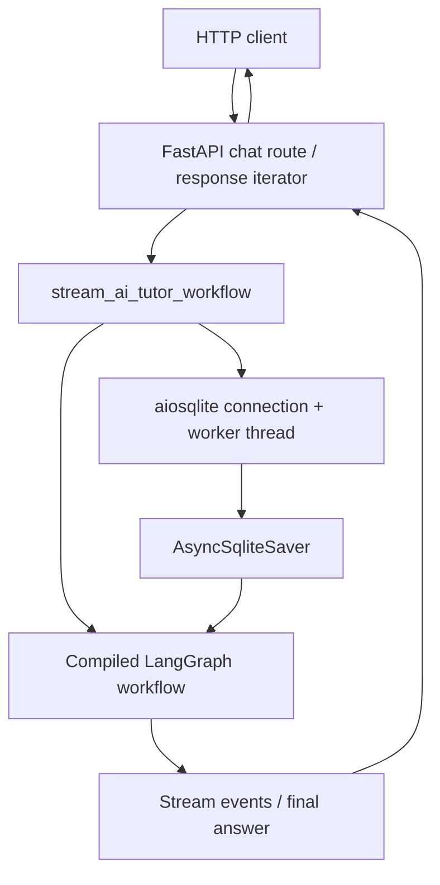
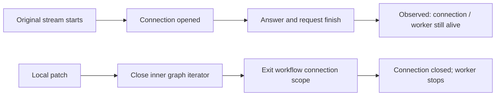

# Learn with GenAI: HTTP and SQLite lifecycle

Assessed application: `vandenn/learn-with-genai`, tag `v0.1.1`, commit `8372d4a58becafa9e7d1e5263c7f064b42da9026`. The assessed route is `POST /api/v1/ai-tutor/chat`. This is an application case study, not a finding against the LangGraph library.

## Components and ownership

The workflow opens the SQLite connection. The graph saver uses it for checkpoints. Completing an HTTP response does not itself release that separately owned database resource.

## Expected, observed and fixed paths

| Path | Recorded behavior |
| --- | --- |
| Expected | Stream ends or exits → close its iterator → release the owned connection and worker. |
| Original application | Ordinary request returned its final response; the retained SQLite connection remained usable and its worker remained alive. |
| Local patch | Scoped connection ownership plus explicit iterator closure released the resource in covered tests. |

The two rows are separate original and patched runs. The response wrapper also closes its workflow iterator; see [changes.patch](changes.patch) for the implemented ownership and cleanup order.

## What was measured

[observations.json](evidence/observations.json) records two sequential original HTTP responses with retained counts `[1, 2]`, a patched single-response control with the connection released and worker stopped, and nine regression cases.

The same nine tests went from **1 pass / 8 failures** on original code to **9 passes** after the local patch. Completion, error, cancellation, explicit iterator closure and checkpoint resume are covered within the documented harness.

Resource retention is established. Resource exhaustion, a service outage and an attacker-controlled availability failure were not established. This documentation update does not run the target again.

Read next: [reading guide](READING-GUIDE.md) → [evidence scope](evidence/README.md).
