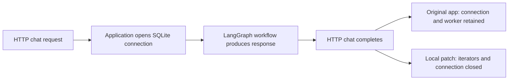
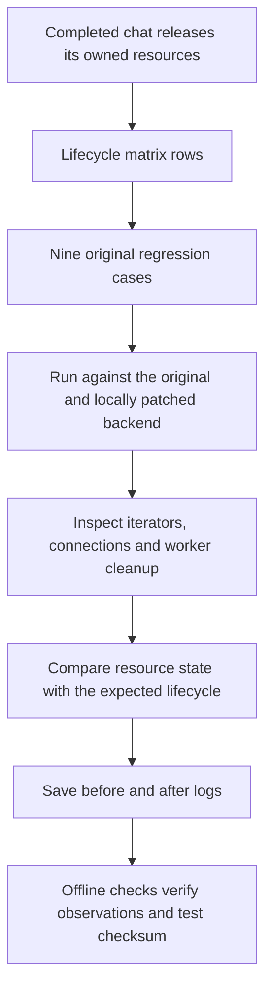
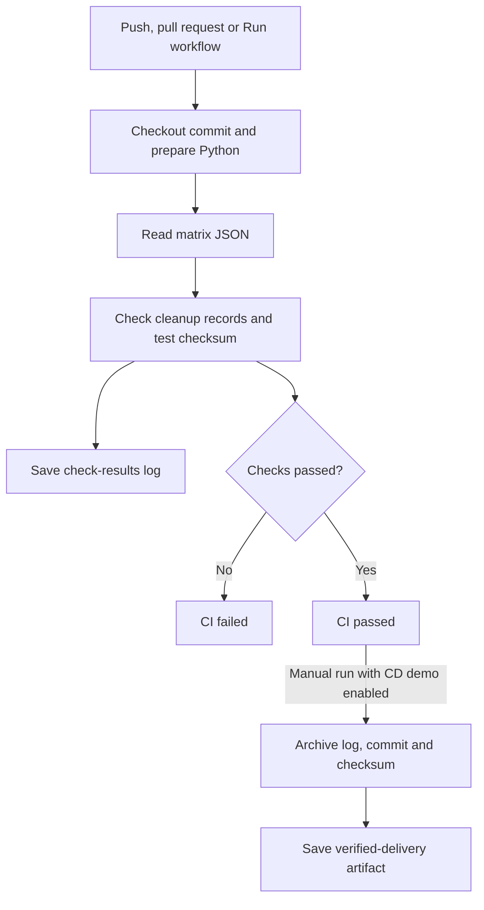

# Learn with GenAI: chat ended, SQLite resources stayed open

**Status:** application lifecycle bug; local fix verified. Exploitable DoS not established.

The chat endpoint runs a LangGraph workflow with SQLite checkpoints.

- **Expected:** finish the response, close its iterators, release the connection and worker.
- **Observed:** two ordinary chats finished but left two connections and worker threads alive.
- **Impact:** unused resources remained allocated. The next request still worked; exhaustion, an outage and data disclosure were not demonstrated.
- **Local fix:** scope the connection with `async with` and close iterators in ownership order. The same nine tests changed from **1 pass / 8 failures** to **9 passes**. Not submitted or merged upstream.

This is an application bug, not a demonstrated LangGraph library vulnerability.

## Where to start

| Open | What you will find |
| --- | --- |
| [Flow](#flow) | Follow a chat response from connection setup to cleanup. |
| [Testing pipeline](#testing-pipeline) | See how the same lifecycle checks were compared before and after the local fix. |
| [Original tests](regression/test_ai_tutor_connection_lifecycle.py) | Read the lifecycle checks used in the before-and-after comparison. |
| [Saved observations](evidence/observations.json) · [Before](evidence/red-unit.log) · [After](evidence/green-unit.log) | Compare the recorded cleanup results before and after the local fix. |
| [GitHub Actions](#github-actions) | Run checks on the saved evidence and test file checksum. |

## Boundaries, tests and evidence

Open the [boundary index](matrices/boundaries.json), [nine original lifecycle tests](regression/test_ai_tutor_connection_lifecycle.py) and [recorded results](evidence/observations.json). The original test source matches the checksum from the recorded run. The [before log](evidence/red-unit.log) and [after log](evidence/green-unit.log) show the individual outcomes.

To run the original suite, use the pinned upstream backend with the [recorded local patch](https://github.com/Keedz1Off/learn-with-genai-resource-lifecycle-case-study/blob/59ea74ee36db31da912d2afbe49af924fcb83cdc/changes.patch) and [recorded dependencies](evidence/requirements.txt). From the patched backend, run `python -m unittest discover -s tests -v` in its configured environment. [Offline Python checks](tests/test_recorded_evidence.py) work directly in this repository.

Run the offline evidence checks from the repository root with Python 3.10 or later.

```sh
python -B -m unittest discover -s tests -v
```

## Flow



## Testing pipeline

The original regression suite measured the resources owned by each chat request. The same nine cases were run before and after the local cleanup change.



| Part | Open |
| --- | --- |
| Resource ownership rules | [Workflow lifecycle](matrices/WORKFLOW-LIFECYCLE.json) and [HTTP lifecycle](matrices/HTTP-LIFECYCLE.json) |
| Original runtime assertions | [Nine regression tests](regression/test_ai_tutor_connection_lifecycle.py) |
| Before and after observations | [Results](evidence/observations.json), [before log](evidence/red-unit.log) and [after log](evidence/green-unit.log) |
| Current CI assertions | [Offline Python tests](tests/test_recorded_evidence.py) |

Actions verifies the saved observations and regression-source checksum. The original runtime suite uses the pinned backend and setup described above.

## GitHub Actions

Open [Case study checks](https://github.com/Keedz1Off/learn-with-genai-resource-lifecycle-case-study/actions/workflows/checks.yml) and click **Run workflow**. CI reads the matrix JSON and checks the saved evidence offline. The run saves a `check-results` log. Select **CD demo** to also download `verified-delivery` with the log, commit SHA and checksum after checks pass.

### CI flow



### What happens in Actions

| Step | What it does |
| --- | --- |
| Checkout and Python | GitHub runs the selected commit on Ubuntu with Python 3.12. |
| Matrix JSON | CI requires the boundary index and reads every JSON file in the matrices folder. |
| Evidence tests | Two tests check the saved cleanup observations and the original regression test file's checksum. |
| Check log | CI uploads the result as `check-results`. |
| CD demo | After a passing manual run, CI saves the log, commit SHA and SHA-256 checksum as `verified-delivery`. |

[See the workflow file](.github/workflows/checks.yml). This job checks the material shipped in this repository offline.

## JSON matrices

| Boundary checked | JSON matrix |
| --- | --- |
| Iterator and connection lifecycle | [WORKFLOW-LIFECYCLE](matrices/WORKFLOW-LIFECYCLE.json) |
| HTTP completion and retained resources | [HTTP-LIFECYCLE](matrices/HTTP-LIFECYCLE.json) |

## How to read

Read the summary and flow, then choose a JSON matrix above. Expand **Technical details** for field guidance, supporting records and exact versions.

<details>
<summary>Technical details: reading guide and evidence</summary>

1. Read the summary and flow for resource ownership and the local cleanup fix.
2. Open [HTTP-LIFECYCLE](matrices/HTTP-LIFECYCLE.json): `LG-HTTP` compares before/after; `LG-NEXT-REQUEST` checks the next ordinary request. Use [WORKFLOW-LIFECYCLE](matrices/WORKFLOW-LIFECYCLE.json) for iterator cases.
3. Compare `invariant` (required rule), `oracle` (measurement) and `observed` (result). Follow `evidence[].url` and its optional JSON `pointer`. Read `status` with `limits`; retained resources alone do not prove an outage.

[Evidence archive: detailed report and recorded results](https://github.com/Keedz1Off/learn-with-genai-resource-lifecycle-case-study/tree/59ea74ee36db31da912d2afbe49af924fcb83cdc) are preserved in the pinned evidence snapshot. Matrix links open the exact supporting records.

Learn with GenAI v0.1.1, 8372d4a; local deterministic model. Independent, AI-assisted work. [File inventory](package-manifest.json).

</details>
