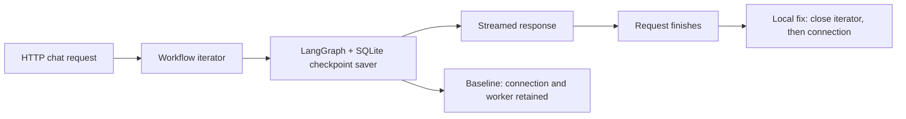

# SQLite resource-lifecycle bug in a LangGraph application

Classification: confirmed application bug with potential availability impact; not a confirmed security vulnerability.

[Upstream bug report](https://github.com/vandenn/learn-with-genai/issues/19) · [Local patch and tests](changes.patch)

## Start here

This is a simplified **application lifecycle** diagram. The retained resources were observed after request completion; they were not shown to make the database publicly accessible.

1. [Architecture, ownership and cleanup flow](FLOW.md)
2. [Reading guide and file map](READING-GUIDE.md)
3. [Local patch and regression tests](changes.patch)
4. [Measured observations](evidence/observations.json) · [before](evidence/red-unit.log) · [after](evidence/green-unit.log)

## Executive Summary

Two sequential ordinary chats in Learn with GenAI returned HTTP 200 and final responses while leaving two SQLite connections and their worker threads alive.

We used AI-assisted source review and local verification against repository tag `v0.1.1`. No affected release range or shipped fix was established.

## Background

`POST /api/v1/ai-tutor/chat` streams a LangGraph workflow that stores checkpoints in SQLite. The workflow owns the connection and should release it when streaming finishes or terminates.

Verification used the real application, nodes, LangGraph 0.6.7, saver, and aiosqlite 0.21.0 with a deterministic local model endpoint. Services ran on loopback with temporary data and a dummy key; external connections were blocked.

Expected flow: chat request → open SQLite checkpoint connection → run LangGraph and stream the answer → close the workflow iterator → close the database connection and stop its worker.

Observed before the patch: the answer and HTTP request finished, but the database connection and its worker remained alive. An open connection means retained process resources; it does not by itself make the database publicly accessible.

## Observed application bug

This is a lifecycle bug in `backend/src/logic/ai_tutor/graphs/main.py`, function `stream_ai_tutor_workflow`: it opens a connection, passes it to `AsyncSqliteSaver`, and yields events without closing it. The HTTP wrapper also lacked explicit closure of its workflow iterator.

See the [assessed source](https://github.com/vandenn/learn-with-genai/blob/8372d4a58becafa9e7d1e5263c7f064b42da9026/backend/src/logic/ai_tutor/graphs/main.py).

After request completion, ASGI task exit, and garbage collection, weak-only observation showed zero application close calls: native SQL remained usable and the worker remained alive.

## Impact and limits

The evidence establishes retained resources and **potential availability impact, not a confirmed exploit**. Two chats increased live connection and worker counts from one to two.

Both connections were outside transactions, and the second request completed normally. No exhaustion, service outage, data disclosure, attacker access, or protected cross-user boundary violation was demonstrated. Deployment limits and long-term impact remain unestablished. No Critical/High severity is claimed.

## Local validation

This is bounded functional validation, not an exploit. See [measured observations](evidence/observations.json), [before-fix results](evidence/red-unit.log), and [after-fix results](evidence/green-unit.log).

The same nine tests produced **1 pass / 8 failures before the patch**, then **9 passes afterward**. Cases cover completion, explicit closure, node errors, cancellation, compilation failure, a pre-allocation negative control, iterator cleanup order, response iterator closure, and real checkpoint interrupt/resume.

With [recorded dependencies](evidence/requirements.txt), apply the patch to the assessed checkout and run from `backend`: `python -B -m unittest discover -s tests -v`.

## Remediation

The [local patch](changes.patch) scopes SQLite with `async with`, closes the graph iterator before releasing its connection, and closes the workflow iterator at the route.

A post-fix HTTP request returned its final answer; the application closed the connection once and the worker stopped. Forced fixture closes: **0**. Ruff and formatting checks passed.

## Summary

The fix releases resources while preserving checkpoint resume. The application fix is provided here as a patch; it has not been submitted or merged upstream. Full UI, upstream-suite, real-LLM, ASGI-disconnect, and repeated-cancellation behavior were not tested.

Patch code comes from the [upstream project](https://github.com/vandenn/learn-with-genai); its backend license is included as [LICENSE-UPSTREAM.txt](LICENSE-UPSTREAM.txt).
